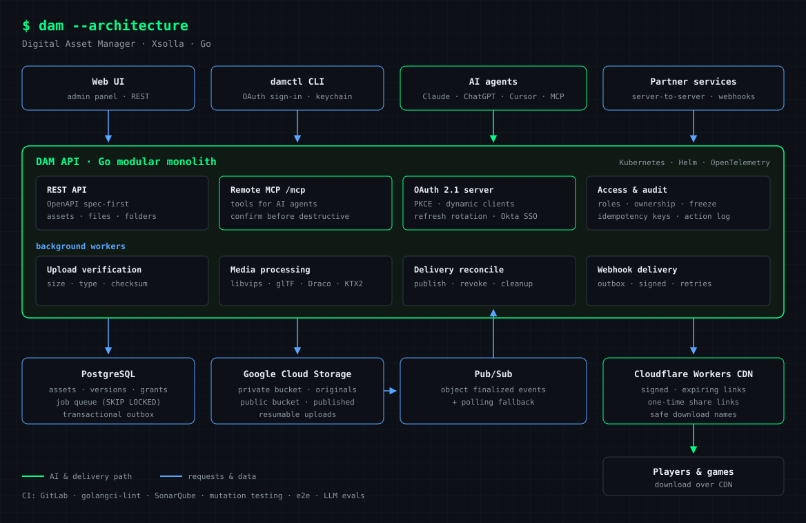
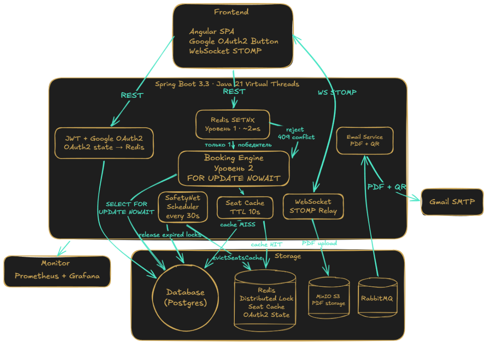

<a id="top"></a>
<div align="center">

<!-- Animated typing header -->


<br/>

<h1 align="center"><a href="#top"> </a></h1>

> *"When you understand how a system works — you start seeing structure in everything."*

<br/>

[](https://t.me/JayceWright)
[](https://jaycewright.github.io)
[](mailto:prog061204@gmail.com)


</div>

---

## `$ whoami`

```yaml
name:       Jayce Wright
role:       Software Engineer
experience: Xsolla — Go (Sep–Nov 2026) · T-Bank — Java (Apr–Jun 2026)
stack:      Go · PostgreSQL · Google Cloud · Kubernetes · Java 21 · Spring Boot
focus:      APIs for humans and AI agents, MCP, fault-tolerant backends
languages:  Russian (native) · English (C1)
location:   Perm, Russia · open to Moscow, Yekaterinburg, remote
status:     Open to full-time roles
```

Building backends that keep working under load and are easy to integrate with.  
At Xsolla: built in Go a service that stores and delivers game assets, for people and AI agents alike.

---

## `$ cat work/xsolla.md`

### 🗂️ Digital Asset Manager `Xsolla · Go · Sep–Nov 2026`

A service that stores, processes and delivers game assets (images, 3D models, files) for Xsolla.

- **Uploads & processing** — resumable uploads to Google Cloud Storage, image and 3D model processing (libvips, glTF, Draco, KTX2), file versions and folders
- **CDN delivery** — Cloudflare Workers with signed, expiring and one-time download links
- **`damctl` CLI** — OAuth sign-in and the full asset workflow from the terminal
- **Remote MCP server** — AI agents (Claude, ChatGPT, Cursor) search, upload and manage assets through the [Model Context Protocol](https://modelcontextprotocol.io), with confirmations before destructive actions
- **OAuth 2.1 authorization server** for MCP clients — PKCE, dynamic client registration, refresh-token rotation, Okta sign-in
- **Account webhooks** — Standard Webhooks signatures, transactional outbox, retries, SSRF protection
- **LLM evals** — a test bench that measures how reliably different models pick the right tool, with cost tracking
- **Spec-first REST API** — OpenAPI as the source of truth, code generation, CI gates for contract drift, mutation testing on changed lines

### `$ open dam-architecture.svg`
<div align="center">
  
</div>

**Stack:** `Go` `PostgreSQL` `OpenAPI` `MCP` `OAuth 2.1` `Google Cloud Storage` `Pub/Sub` `Cloudflare Workers` `TypeScript` `OpenTelemetry` `Kubernetes` `Helm` `GitLab CI` `SonarQube` `k6`

---

## `$ cat achievements.log`

🏆 **Kod Sporta — Winner** `T-Bank 2026`  
&nbsp;&nbsp;&nbsp;&nbsp;Team Competitive Programming Contest. Team of 3. Work under pressure, won under pressure.

🏦 **Backend Lead** `T-Bank × HSE Practicum 2026`  
&nbsp;&nbsp;&nbsp;&nbsp;Led a 5-person team for 10 weeks, built the CI/CD pipeline from scratch. Public defence before T-Bank and HSE jury.

---

## `$ cat projects.md`

<table>
<tr>
<td width="65%">

### 🎫 [T-Reserve Engine](https://github.com/TicketRace/T-RESERVE-ENGINE)
`T-Bank × HSE · Production · Backend Lead`

Seat booking for the moment sales open — concerts, cinemas, sports: few seats, thousands of fans hitting the same ones at once.
- **Redis SETNX** absorbs the rush — ~2 ms reject, 999 of 1000 requests for a taken seat never reach the database
- **PostgreSQL `SELECT FOR UPDATE NOWAIT`** guarantees the sale — one winner, zero double-bookings, even with Redis down
- **SafetyNet** frees expired holds every 30 s (partial index) · **graceful degradation** to PostgreSQL only
- **WebSocket STOMP** live seat map · **RabbitMQ** pipeline: PDF → MinIO → email
- **2 instances behind Nginx**, stateless JWT · CI: JUnit → Testcontainers → Playwright E2E → deploy

</td>
<td width="35%" align="center">

`k6 · 1000 VU on one seat`

| | PG only | Redis + PG |
|---|---|---|
| ⚡ Avg | 450–670ms | **250ms** |
| 📊 p95 | 780–1210ms | **465ms** |
| 🗄️ DB transactions | 300–500 | **1** |
| ❌ 5xx | cascading | **0** |

</td>
</tr>
</table>

**Stack:** `Java 21` `Spring Boot 3.3` `PostgreSQL 16` `Redis 7` `RabbitMQ` `MinIO` `Angular 17` `Docker` `Nginx` `Prometheus` `Grafana` `k6` `Testcontainers` `Playwright` `GitHub Actions`

### `$ open architecture.svg`
<div align="center">
  
</div>

---

## `$ cat stack.json`

```json
{
  "languages":   ["Go", "Java 21", "TypeScript", "JavaScript", "Python", "C#", "SQL", "Bash"],
  "frameworks":  ["oapi-codegen", "MCP Go SDK", "Spring Boot 3", "Spring Security", "Spring Data JPA",
                  "FastAPI", "Angular 17"],
  "databases":   ["PostgreSQL", "Redis", "Flyway", "Hibernate", "SQLAlchemy"],
  "messaging":   ["RabbitMQ", "Google Pub/Sub", "WebSocket STOMP", "Webhooks"],
  "cloud":       ["Google Cloud Storage", "Cloudflare Workers", "MinIO S3", "Kubernetes", "Helm"],
  "infra":       ["Docker", "GitLab CI", "GitHub Actions", "Maven", "Nginx", "Railway", "Linux"],
  "security":    ["OAuth 2.1 / PKCE", "Okta", "JWT", "BCrypt", "RBAC"],
  "monitoring":  ["OpenTelemetry", "Datadog", "Prometheus", "Grafana"],
  "testing":     ["Mutation testing", "LLM evals", "k6", "JMeter", "JUnit 5", "Mockito",
                  "Testcontainers", "Playwright", "SonarQube"],
  "ai":          ["MCP", "Claude Code", "Codex", "Cursor"],
  "patterns":    ["Spec-first API", "Transactional Outbox", "Distributed Locking", "Idempotency keys",
                  "State Machine", "Cache-Aside", "Circuit Breaker", "Graceful Degradation",
                  "Ports & Adapters"]
}
```

---

## `$ git log --stat`

<div align="center">

<a href="#stats"></a>

<br/><br/>

<a href="#stats"></a>

</div>

---

<div align="center">

```
[SYSTEM ONLINE] :: Backend that survives production. Architecture that scales.
```

**[jaycewright.github.io](https://jaycewright.github.io)** · Built by Jayce Wright · 2026

</div>
